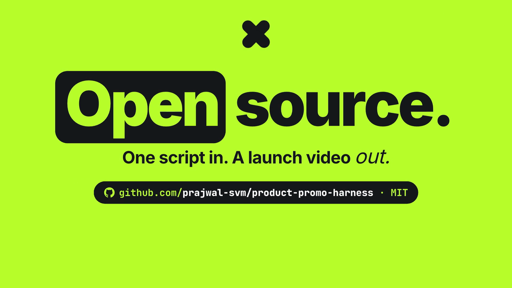

# product-promo-harness

**One script in. A launch video out.**

A [Claude Code](https://claude.com/claude-code) harness for showreel-grade product promos, launch stings and
explainers. You write the script and the shot list; the harness voices it, scores it on the beat, renders animated
HTML scenes to 60 fps video, lays the sound effects, captions it, masters the mix and checks its own work.

[](docs/media/harness-launch.mp4)

*The 10 s clip above was made with this harness: [`examples/promo/harness-launch`](examples/promo/harness-launch).
The 8-minute [Oleafly tour](https://youtu.be/egS6HiWAABU) is a long-form film made with it.*

## What it does

| Step | Command | How |
| --- | --- | --- |
| Script → timing | `promo timing` | `shotlist.json` is the only authored timing source: every event is anchored to a word, a beat, a bar or a shot edge |
| Voice | `promo voice --all` | Supertonic (local, free, no key) or Gemini TTS; every take is checked by speech recognition and retaken on a miss |
| Music | `promo music` | a Lyria or ElevenLabs bed planned per section, conformed to the beat grid, checked for vocals |
| Scenes | `promo scenes` | [HyperFrames](https://github.com/heygen-com/hyperframes) compositions (HTML + GSAP), one per shot, rendered headless at 60 fps |
| Sound effects | `promo sfx render` | one sound per event, its peak on the event's frame |
| Captions | `promo captions` | word-level SRT and VTT, an optional burned-in overlay |
| Master | `promo assemble` | OpenTimelineIO assembly, VO ducking, mastered to −14 LUFS (true peak measured on the MP4) |
| Checks | `promo verify`, `promo critique` | scene determinism (forward vs reverse seek), then a critic round with evidence sheets |

Claude Code drives all of it through the bundled skills (`promo-video`, `promo-script`, `promo-voice`,
`promo-captions`, `promo-critic`): say *"cut a launch video for this project"* in any repo and the `promo-video`
skill takes over.

## What it is not

- **Not one-click.** The scenes are code that the agent writes for each film, following the skills and the pack's
  design rules. That is where the quality comes from, and where most of the time goes.
- Not a camera-footage editor, a talking-head generator or a text-to-video model.
- Tested on macOS (Apple Silicon) at 16:9. `--aspect 9:16` and `1:1` are wired in but less tested.

## Requirements

- macOS, Python 3.12 and [uv](https://docs.astral.sh/uv/), Node.js 22+ (HyperFrames runs through `npx`), ffmpeg (with ffprobe)
- Optional: the `supertonic` CLI for the free local voice
- Speech recognition runs locally (parakeet-mlx / mlx-whisper, Apple Silicon)
- Keys, only for what a film uses (in `.env`, never committed):

| Key | Used for |
| --- | --- |
| `GEMINI_API_KEY` | Gemini TTS voices and Lyria music |
| `ELEVENLABS_API_KEY` | ElevenLabs music beds and generated sound effects |

A film voiced by Supertonic, with procedural sound effects and no generated music, needs no key at all.

## Install

```bash
git clone https://github.com/prajwal-svm/product-promo-harness
cd product-promo-harness
scripts/install.sh      # the `promo` CLI on PATH, the skills linked into ~/.claude/skills, .env from .env.example
promo doctor            # checks tools, models, keys and disk
```

## The pipeline

Each video is a run folder inside your project, `promo/<slug>/`. Run the commands from inside it:

```bash
promo new my-launch --pack saas-kinetic --aspect 16:9   # scaffold the run folder
promo lint-script && promo timing && promo script      # shot list → timing.json → script.md
promo voice --all                                      # VO takes, verified by speech recognition
promo music                                            # optional: a generated bed and its beat grid
promo timing                                           # snap to the real takes and the measured grid
promo sfx render                                       # one sound per event
promo guide && promo scenes --stills                   # animation guide, then key frames of every shot
promo scenes && promo captions && promo assemble       # shots, captions, the mastered MP4
promo verify && promo critique                         # determinism, then a critic round
promo ship --reveal                                    # poster, critic gate, README, Finder
```

`promo beats` measures a music track you supply, and `promo ref` audits a reference video. Every command has
`--help`. `timing.json` is derived; never edit it by hand.

## Layout

- `promo/`: the CLI. `packs/`: design systems (`_core` holds the doctrine, the scene template and the caption
  overlay). `templates/run/`: what `promo new` scaffolds.
- `skills/`: the Claude Code skills. `scripts/install.sh`: the install.
- `examples/promo/harness-launch/`: a complete run (sources committed, renders ignored).
- `docs/api-notes.md`: what live runs taught us about HyperFrames, the TTS providers and the music APIs.

## Costs

Supertonic voices are free. A Gemini-voiced 8-minute film costs cents in TTS; a Lyria music call is about $0.08;
ElevenLabs sound effects are cached, so each prompt is paid once. Every paid call is logged to the run's
`costs.jsonl`.

## Tests

`uv run pytest` runs the unit tests; `uv run pytest -m live` also runs the ones that call real APIs or render.

## Licence

MIT, see [LICENSE](LICENSE). Bundled third-party files keep their own licences; see [NOTICE.md](NOTICE.md).
